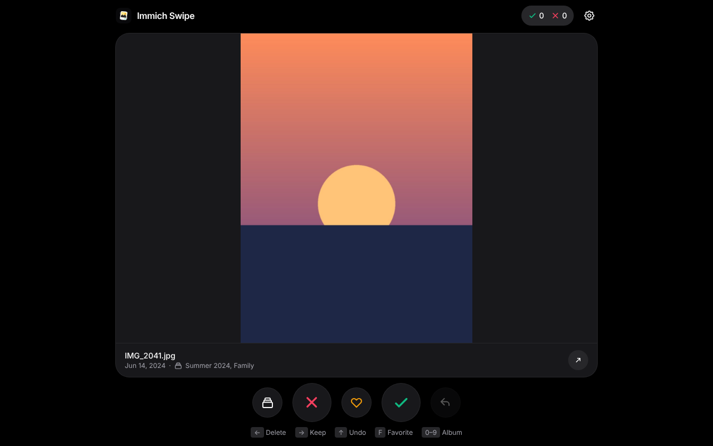
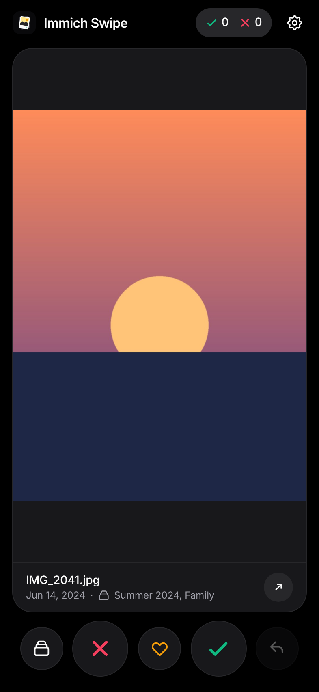
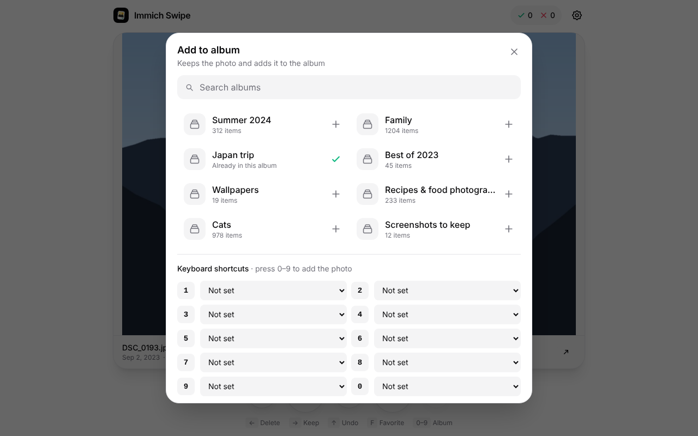
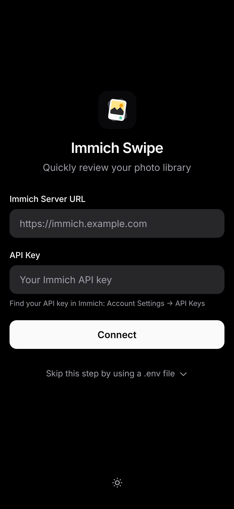

# Immich Swipe

Swipe-review your Immich library: right = keep, left = trash. Like a dating app, but for photos (and videos).


<p align="center">
  
</p>

<p align="center">
  
</p>

<p align="center">
  
</p>

> Screenshots are sanitized (no real photos or API keys).

## Features

- Swipe (touch/mouse) or use keyboard/buttons
- Random or chronological review (oldest/newest first)
- Skip videos toggle
- Favorite toggle (press `F`)
- Add-to-album (+ configurable `0–9` hotkeys)
- Undo (Ctrl/⌘+Z or ↑)
- Reviewed cache + stats persisted per server/user
- Preloads the next asset

## Controls

| Action | Gesture / Key | Button |
|---|---|---|
| Keep | Swipe right / `→` | ✓ |
| Delete (moves to trash) | Swipe left / `←` | ✕ |
| Undo | `Ctrl/⌘+Z` or `↑` | ↶ |
| Favorite | `F` | ♡ |
| Add to album | `0–9` (configured) | Album icon |

## Quickstart

### Local development

```bash
npm install
npm run dev
```

Open `http://localhost:5173`.

### Docker (prebuilt image)

```yaml
services:
  immich-swipe:
    image: ghcr.io/dev-nick421/immich-swipe:latest
    restart: unless-stopped
    ports:
      - "2293:80"
    environment:
      # Your Immich URL, as reachable from this container (see "Connecting to Immich" below)
      - IMMICH_URL=http://192.168.1.10:2283
```

Open `http://<host>:2293` and log in with your Immich server URL and an API key.

### Docker (build with `.env` users)

```bash
cp env.example .env
# edit .env
docker compose up -d --build
```

Open `http://localhost:2293`.

`VITE_SERVER_URL` is the only URL you need: the container also forwards API calls to it (built-in proxy, see below).

Note: `VITE_*` values from `.env` are passed as build args and end up in the frontend bundle, so changing them requires `docker compose up -d --build`. The optional `IMMICH_URL` is read when the container starts; changing it only needs `docker compose up -d`.

### GitHub Pages

This repo includes a GitHub Actions workflow that builds and deploys the SPA to GitHub Pages on every push to `main`.

After enabling Pages in your repo settings, your URL will be:
- `https://<owner>.github.io/<repo>/`

<details>
  <summary>Login screen</summary>
  <p align="center">
    
  </p>
</details>

## Configuration

### Option A: `.env` users (build-time)

See `env.example`.

```bash
VITE_SERVER_URL=https://immich.example.com
VITE_USER_1_NAME=User 1
VITE_USER_1_API_KEY=your-api-key
```

Tip: `VITE_SERVER_URL` can be the base URL (recommended) or end with `/api` — the app normalizes it.

Behavior:
- 1 user configured: auto-login
- >1 users configured: user selection screen (`/select-user`)
- no `.env` users: manual login (`/login`), stored in `localStorage`

If `VITE_USER_<N>_NAME` is empty, the user is shown as `User <N>`.

Note: user slots are currently wired up to `VITE_USER_5_*` in `src/vite-env.d.ts`, `Dockerfile`, and `docker-compose.yml`.

When the `.env` users or `VITE_SERVER_URL` change, a login stored in the browser from the previous build is discarded automatically.

Security note: `VITE_*` variables are embedded into the compiled frontend. Only use `VITE_USER_*_API_KEY` for private deployments/images.

### Option B: manual login (runtime)

If you don’t configure `.env` users, the app asks for:
- Immich Server URL
- API key

Those values are stored in `localStorage` under `immich-swipe-config`.

## Connecting to Immich

Immich Swipe has no backend: your browser calls Immich's API (`/api/...`) with the `x-api-key` header. Immich only sends CORS headers in development builds, so a browser on another origin (the Immich Swipe URL) is blocked unless one of the following is set up.

### Option 1: built-in proxy (Docker image, recommended)

The container forwards `/api/` to Immich. Browser and API share one origin, so no CORS configuration is needed. The proxy's target is your Immich URL:

- image built with `.env`: `VITE_SERVER_URL`, nothing else to configure
- prebuilt image (built without `VITE_SERVER_URL`): set `IMMICH_URL` to your Immich URL

Both are normally the same address, the one you open Immich with in your browser. Set `IMMICH_URL` in addition to `VITE_SERVER_URL` only if the container has to reach Immich under a different address than your browser: `http://immich-server:2283` on Immich's Docker network (see `docker-compose.yml`), or a LAN IP like `http://192.168.1.10:2283` when your public domain is not reachable from inside your network. The browser keeps using the server URL (login or `VITE_SERVER_URL`) for the "Open in Immich" button.

`docker logs immich-swipe` shows whether the proxy is enabled and which address it uses. `http://<host>:2293/config.js` shows `proxy: true` when it is on.

### Option 2: CORS headers on your reverse proxy

When the proxy is off (prebuilt image without `IMMICH_URL`, or the static build hosted elsewhere, e.g. GitHub Pages), the browser calls the Immich server URL directly. Add CORS headers in the reverse proxy in front of Immich (for Nginx Proxy Manager: the Immich proxy host's configuration):

```nginx
add_header 'Access-Control-Allow-Origin' '*' always;
add_header 'Access-Control-Allow-Methods' 'GET, POST, PUT, PATCH, DELETE, OPTIONS' always;
add_header 'Access-Control-Allow-Headers' 'X-Api-Key, User-Agent, Content-Type, Authorization, Range, Accept' always;
add_header 'Access-Control-Expose-Headers' 'Content-Length, Content-Range, Accept-Ranges' always;
if ($request_method = OPTIONS) { return 204; }
```

Tip: replace `*` with your Immich Swipe origin (e.g. `https://swipe.example.com`) to allow only that site.

Check it from any machine; the response must contain `Access-Control-Allow-Origin`:

```bash
curl -i -X OPTIONS https://immich.example.com/api/users/me \
  -H "Origin: http://<immich-swipe-host>:2293" \
  -H "Access-Control-Request-Method: GET" \
  -H "Access-Control-Request-Headers: x-api-key"
```

See also: https://docs.immich.app/administration/reverse-proxy/

## Troubleshooting

The login screen and the error screen show what went wrong. More details are in the browser console (F12).

| Message | Cause / fix |
|---|---|
| `Could not reach Immich at …` (browser: "Failed to fetch", "NetworkError …", "Load failed") | Immich is not reachable from the browser or does not allow CORS. Use the built-in proxy or add CORS headers (see above). |
| `… this page uses HTTPS, the Immich server URL uses HTTP …` | Browsers block HTTP requests from HTTPS pages. Use an `https://` server URL, or the built-in proxy. |
| `The built-in proxy could not reach Immich (HTTP 502)` | The container cannot reach Immich under `VITE_SERVER_URL` / `IMMICH_URL`. Check `docker logs immich-swipe`, test with `docker exec immich-swipe wget -qO- <url>/api/server/ping` and set `IMMICH_URL` to an address the container can reach. |
| Container exits with `error: IMMICH_URL must be …` | `IMMICH_URL` needs scheme, host and optional port, e.g. `http://immich-server:2283`. |
| `Invalid API key` / `Missing required permission: …` | Wrong key, or the key lacks a permission (see below). |
| `Unexpected response … (not JSON)` / `… not found. Does the server URL point to Immich?` | The server URL points to another web app (e.g. Immich Swipe itself) instead of Immich. |

Did the `.env` values make it into the build? The browser console logs `[Auth] VITE_SERVER_URL: …` and `[Auth] Found <n> users` on page load. If not, rebuild with `docker compose up -d --build`.

## Compatibility

Requires Immich v1.116 or newer, including v2.x and v3.x.

## Stored data (localStorage)

- `immich-swipe-config` (current login: server URL, API key, user name)
- `immich-swipe-theme`
- `immich-swipe-skip-videos`
- `immich-swipe-stats:<server>:<user>` (keep/delete counters)
- `immich-swipe-reviewed:<server>:<user>` (already reviewed IDs + decision)
- `immich-swipe-preferences:<server>:<user>` (order mode + album hotkeys)

## Immich API key permissions

An API key with all permissions works. For a restricted key, grant:

| Feature | Permission |
|---|---|
| Login / connection check | `user.read` |
| Load photos | `asset.read` |
| Show photos | `asset.view` |
| Play videos | `asset.download` |
| Delete (trash) and undo | `asset.delete` |
| Favorite | `asset.update` |
| List albums | `album.read` |
| Add to album | `albumAsset.create` |

## Development scripts

- `npm run dev` (Vite, `5173`, `--host`)
- `npm run build`
- `npm run preview`
- `npm run type-check`
- `npm test`
- `docker/smoke-test.sh <image>` (Docker image smoke test, also run in CI)

## License

[MIT](LICENSE)
